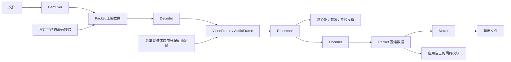

# 核心概念与执行约定

[文档首页](README.md)

## 1. 数据怎样流动



这些对象可独立使用。网络数据解码不必创建 Demuxer；原始帧编码不必创建输出文件。

| 对象 | 表示什么 | 典型用途 |
| --- | --- | --- |
| `Packet` | 某个编码格式的压缩数据 | 解码输入、编码输出、转封装 |
| `VideoFrame` | 一帧原始像素及其格式和时间 | 算法、渲染、缩放、编码 |
| `AudioFrame` | 每个声道的一段原始采样 | 播放、重采样、编码 |
| `CodecParameters` | 编码格式和解码初始化信息 | 创建解码器、注册输出流、配置接收端 |
| `StreamInfo` | 容器内一条流的描述 | 分发音视频包、取得时间基和编码参数 |

`Packet` 没有“来自网络”的隐含含义。TCP 片段、RTP 包、完整视频编码包不是同一层数据。
应用应先按协议重组，再把完整的编码数据交给解码器。

## 2. 为什么有的函数返回结果，有的使用回调

视频空间处理通常一帧进、一帧出：

```cpp
auto output = video.process(frame);
```

编解码和重采样可能一次没有结果，也可能交付多个结果：

```cpp
decoder.decode(packet, on_frame);
encoder.encode(frame, on_packet);
audio.process(frame, on_audio);
```

回调只在有结果时执行。一次方法调用结束不代表输入对应的全部延迟结果都已产生。
需要更多输入数据的正常情况不会抛异常，也不要求应用处理 EAGAIN。

回调是传给库的可调用对象，例如：

```cpp
int frame_count = 0;
auto on_frame = [&](const fflite::VideoFrame& frame) {
    ++frame_count;
    // 在这里读取、保存或转交 frame。
};
decoder.decode(packet, on_frame);
```

创建 lambda 时不会执行函数体。库产生结果后才调用它。
`[&]` 使函数体可以引用外面的 `frame_count` 等局部变量。

方法和结果回调同步执行于调用线程，不会将回调保存到下一次调用或后台线程。
底层编解码器可以使用内部工作线程，数量由编解码配置控制；这不改变回调的执行约定。

## 3. 数据所有权

Packet、VideoFrame、AudioFrame 是可复制的持有型对象，复制默认共享底层数据引用。

```cpp
auto retained = frame;          // 低成本保留数据
auto independent = frame.clone(); // 显式深拷贝
```

回调参数本身是临时借用引用，在回调结束后不能继续使用该引用。
异步使用结果时，把值对象复制到应用自己的队列：

```cpp
std::vector<fflite::VideoFrame> saved;
auto on_frame = [&](const fflite::VideoFrame& frame) {
    saved.push_back(frame);
};
```

只保存 `frame.plane(0).data` 或 `packet.data()` 的裸指针不能保留数据生命周期。
复制值对象不意味着深拷贝像素；引用计数会使底层内存持续存活。

需要修改帧时使用 `writable_plane()`。如果数据已共享，库先执行写时复制：

```cpp
auto a = frame;
auto b = a;
auto writable = b.writable_plane(0);
// 通过 writable 写入，不会修改 a 的数据。
```

先完成写入，再把帧交给其他模块。已取得的裸可写指针不能在帧继续复制、共享后仍被任意写入，
否则会绕过后续方法调用中的写时复制检查。

## 4. 结束输入和排空

`flush()` 表示“这段输入已经结束，请交付内部剩余结果”。
它不是播放刷新、重新初始化，也不是要求每输入一帧就调用。

```text
多次 decode / encode / process
            ↓
输入真正结束
            ↓
flush(callback)
            ↓
交付延迟结果，进入 Drained
```

多个对象串联时，按数据流方向排空：

```cpp
decoder.flush(on_decoded_frame);   // 回调可能继续送入处理器、编码器
audio.flush(on_processed_audio);   // 有音频处理器时，继续送入编码器
encoder.flush(on_encoded_packet); // 回调可能继续写入封装器
muxer.finish();                   // 最后写入容器尾部
```

上例表示各步骤的关系，不要求纯视频处理创建 AudioProcessor。
`VideoProcessor` 的空间处理直接返回结果，没有 flush。
各对象的 flush/finish 成功后重复调用安全。析构只释放资源，不执行用户回调，也不替代正常结束操作。

## 5. reset 与状态

| 状态 | 含义 | 后续操作 |
| --- | --- | --- |
| Ready | 已构造或正常 reset 后 | 可以开始输入 |
| Running | 已开始处理 | 可以继续输入、正常排空 |
| Drained | 已正常排空 | 重复排空安全；继续输入错误 |
| Failed | 运行过程失败或回调抛异常 | 重建对象 |

VideoDecoder/AudioDecoder 的 reset 丢弃尚未交付的帧及解码参考状态，保留编码配置。
AudioProcessor 的 reset 丢弃尚未交付的样本和时间累计，保留已设定的参数，允许重新配置。
这些 reset 不接受已经 Failed 的对象。

seek 后应 reset 关联解码器。重置后仍需从可解码边界继续输入，reset 不会补回缺失参考帧。
编码器没有 reset；新的编码会话创建新对象。

执行中的对象不允许在自己的回调里递归调用自身。可以在解码器回调里调用另一个处理器或编码器。

## 6. 配置何时生效

编解码器的选项在构造时固定。要更换输出尺寸或编码标准，创建新编码器。
VideoProcessor 在第一次 process 之前配置；之后追加操作会报错。
AudioProcessor 在第一次 process 之前或正常 reset 之后配置。

视频的 crop、resize、format 按调用顺序追加。
音频的 resample、format、volume 设置目标参数，重复设置同一项采用最后一次值，
不是按方法调用顺序追加多个音频滤镜。

## 7. 时间与线程

PTS 是呈现时间，DTS 是解码时间；存在 B 帧时它们可以不同。
时间基表示每个 tick 的秒数，库在各对象之间自动换算，不要求应用调用 FFmpeg 的 rescale。
应用仍应提供真实采集时间，或为无时间戳的视频配置 fps。
详细规则见[类型与时间](api/types.md)和[编码器](api/codecs.md)。

单个执行对象的调用必须串行，配置、reset、flush 也包含在内。
应用可以把不同对象放到不同线程，跨线程传递持有型数据对象；同一个包装对象的并发读写由应用同步。
库不提供播放器时钟、自动等待、业务队列背压或协议重传。
