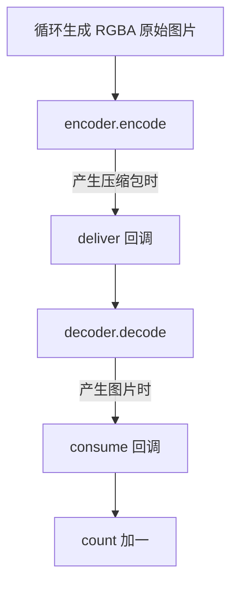

# memory.cpp 逐行详解

[文档首页](../README.md) · 原始示例：[examples/memory.cpp](../../examples/memory.cpp) · 带中文注释的完整版本：[memory_walkthrough.cpp](../examples/memory_walkthrough.cpp)

## 1. 程序要验证什么

程序在内存里自己生成 12 张图片，把图片编码为 MPEG-4，再把编码结果解码回图片，
最后统计解码器交付了多少张图片。



所有工作在内存里完成。程序不读取视频文件、不生成 MP4，也没有播放窗口。
运行成功会输出 `12 frames encoded and decoded entirely in memory`。
这个例子验证的是组件能否组合及延迟帧能否排空，不是图像质量或性能测试。

## 2. 先区分图片与压缩包

`VideoFrame` 是原始图片。RGBA 格式的每个像素包含 R、G、B、A 四个 8 位分量。
96×64 的一张 RGBA 图像，有效像素字节数是：

```text
96 × 64 × 4 = 24576 字节
```

实际分配空间可能还有行对齐或内部填充，不能把这个公式当作所有图像的缓冲区大小。

`Packet` 是压缩后的编码数据。MPEG-4 会利用图像内容和帧间关系压缩，
包里的字节不能当成 RGBA 像素直接显示。解码器将它还原为原始帧。

```text
VideoFrame  --编码-->  Packet  --解码-->  VideoFrame
```

MPEG4 是视频编码标准，MP4 是文件容器。这里用到前者，没有创建后者。

## 3. 头文件和异常处理

```cpp
#include <cstring>
#include <fflite/fflite.hpp>
#include <iostream>
```

- cstring 提供 std::memset，用来填充图片内存。
- fflite.hpp 是库的聚合头，包含本例需要的公开接口。
- iostream 提供标准输出和错误输出。

main 中的 try 包住整段工作。fflite::Error 派生自 std::runtime_error，
因此会被末尾的 `catch (const std::exception& e)` 捕获，打印 what 并返回 1。
正常执行 main 到末尾相当于返回 0。

## 4. 配置编码器

```cpp
fflite::VideoEncodeOptions options;
options.fps = {25, 1};
options.max_b_frames = 2;
```

第一句创建一份配置，未修改的字段采用默认值，如 2 Mbps 视频码率。
配置对象只是普通参数，不会在这一步开始编码。

fps 是有理数，25/1 表示每秒 25 帧。每帧时间间隔为：

```text
1 / 25 秒 = 0.04 秒 = 40 ms
```

后面创建的原始图片没有设置 PTS，编码器会依据 fps 生成连续时间。
12 帧对应约 0.48 秒内容，帧起始时间依次为 0、40、80……440 ms。
设置 fps 不会让程序每帧 sleep 40 ms；程序会尽快完成这些计算。

max_b_frames=2 允许编码器配置 B 帧，用于测试帧间重排和延迟输出。
这不意味着任何一次 encode 都必然缓存正好两张图，也不等于两个后台线程。
实际何时输出还取决于编码器实现和内部线程。

## 5. 创建编码器

```cpp
fflite::VideoEncoder encoder(fflite::Codec::MPEG4, {96, 64}, options);
```

参数分别是：

| 参数 | 值 | 意义 |
| --- | --- | --- |
| codec | MPEG4 | 请求 MPEG-4 Part 2 视频编码 |
| size | 96×64 | 编码输入必须保持这个尺寸 |
| options | 前面创建的配置 | fps、B 帧及其他编码设置 |

构造时库查找并打开编码器；没有相应实现就抛异常。
之后每次 encode 都使用这个编码会话，不为每张图重新打开编码器。

原始图片是 RGBA，而本例 MPEG4 编码通常使用 YUV420P。
像素存储格式转换由 VideoEncoder 内部负责；输入宽高变化则不会自动缩放。
这个视频编码链不保留 RGBA 的透明度。

## 6. 为编码结果创建解码器

```cpp
fflite::VideoDecoder decoder(encoder.parameters());
```

encoder.parameters 返回编码格式描述，包括解码初始化所需的额外配置。
把它交给 VideoDecoder，解码器就知道后续包应按什么标准和参数解码。

此时还没有图片编码结果，创建解码器只是准备后续处理。
构造过程会读取并保留必要配置，不依赖临时返回对象永久存活。
真实网络场景中，这些配置通常需要通过协议交给接收方；本例在一个进程里直接传递。

## 7. count 和 consume

```cpp
int count = 0;
auto consume = [&](const fflite::VideoFrame&) {
    ++count;
};
```

count 用来统计解码结果数量。consume 是一个 lambda，也就是可以像函数一样调用的对象。
auto 让编译器推导该 lambda 的具体类型。

逐个拆开看：

| 写法 | 含义 |
| --- | --- |
| `[&]` | 允许按引用访问函数体中使用的外部局部变量，这里是 count |
| `const VideoFrame&` | 接收一张帧的只读引用，不因传参而深拷贝像素 |
| 参数没有名字 | 这里只计数，不访问帧内容，所以省略变量名 |
| `++count` | 收到一张解码帧，计数增加 1 |

定义 lambda 不会执行它。定义后 count 仍然是 0。
直到库真的交付解码帧、调用 consume，count 才增加。

如果需要访问图像，可以给参数命名：

```cpp
auto consume = [&](const fflite::VideoFrame& decoded_frame) {
    ++count;
    std::cout << decoded_frame.width() << 'x' << decoded_frame.height() << '\n';
};
```

如果应用希望稍后使用该帧，复制 VideoFrame 到自己的容器即可保留引用；
不能只保存这个 const 引用或平面的裸指针。

## 8. deliver 为什么又调用 decoder

```cpp
auto deliver = [&](const fflite::Packet& packet) {
    decoder.decode(packet, consume);
};
```

deliver 是编码结果的接收函数。编码器产生一个 Packet 后会调用它。
它接到压缩包后，再调用 decoder.decode，将这个包送给解码器。
解码器产生图片后，再通过 consume 交付。

deliver 引用外面的 decoder 和 consume。它们都在 main 中存活到所有输入及排空结束，
所以本例的引用使用有效。

可以将名字换成更明确的形式来理解：

```cpp
auto on_decoded_frame = [&](const fflite::VideoFrame& frame) {
    ++count;
};
auto on_encoded_packet = [&](const fflite::Packet& packet) {
    decoder.decode(packet, on_decoded_frame);
};
```

这两个回调接收不同类型：前者收原始图片，后者收压缩数据。
这里没有“回调自动在后台跑”的机制；它们由当前 encode/decode 调用同步触发。

## 9. 循环生成 12 张图片

```cpp
for (int i = 0; i < 12; ++i) {
    auto frame = fflite::VideoFrame::allocate(96, 64, fflite::PixelFormat::RGBA);
    // 后面填充这张图，再送入编码器。
}
```

i 依次取 0 到 11。每轮创建一张新的原始图片，格式为 RGBA。
allocate 分配数据，不保证像素自动清零，必须先填充再使用。
本例不为 frame 设置 PTS，编码器根据前面的 fps 为它生成时间。

循环结束当前 frame 包装对象会销毁；如果底层编码器仍需要数据，库/FFmpeg 会持有必要引用。
应用无需手写 av_frame_free，也不能在提交后通过遗留裸指针继续改写该帧。

## 10. writable_plane 是什么

```cpp
auto plane = frame.writable_plane(0);
```

RGBA 是单平面格式，所以使用索引 0。plane 是指向帧像素的可写视图：

| 字段 | 本例含义 |
| --- | --- |
| data | 逻辑第一行的首地址 |
| stride | 相邻行首地址的字节距离，可能包含对齐填充 |
| row_bytes | 一行实际像素占用字节，此例为 96×4=384 |
| rows | 当前平面的行数，此例为 64 |

这个视图不拥有数据，真正持有内存的是 frame。
独占数据通常可以直接写；若 frame 与其他对象共享数据，writable_plane 会先执行写时复制。

## 11. 如何填充每一行

```cpp
for (int row = 0; row < plane.rows; ++row)
    std::memset(plane.data + row * plane.stride, 50 + i * 8, plane.row_bytes);
```

三部分分别是：

```text
plane.data + row * plane.stride  当前行起点
50 + i * 8                     写入每个字节的值
plane.row_bytes                写入多少有效字节
```

第 0 行从 data 开始，第 1 行从 data+stride 开始，依此类推。
使用 stride 是为了兼容行对齐，不假定图像所有有效像素紧密连成一块。

i=0 时填 50，i=1 时填 58，最后 i=11 时填 138。
memset 按字节填充，所以每个像素的 R/G/B/A 都是同一个值，例如第一张图为 `[50,50,50,50]`。
这会得到亮度变化的测试图，alpha 同样被写入；它不是规范的“不透明灰色图片”生成器。
如果想明确生成不透明图，应逐像素设置 R/G/B，并令 A=255，见文档中的带注释示例。

## 12. encode(frame, deliver) 执行了什么

```cpp
encoder.encode(frame, deliver);
```

这句将当前原始图片送入编码器，第二个参数说明“有编码结果时交给谁”。
库在内部完成像素格式协商/转换、提交输入和取出当前可用压缩包。
没有包时正常返回；有包时调用 deliver。

一次可能发生的调用栈是：

```text
main
  encoder.encode(frame, deliver)
    deliver(packet)
      decoder.decode(packet, consume)
        consume(decoded_frame)
          ++count
```

也可能本次编码只缓存了输入，deliver 一次都不执行；或者 deliver 执行后解码器暂时没有帧，
consume 没有执行。应用不能在每次 encode 后断言 count 必须加 1。
即使方法调用有先后顺序，呈现时间和压缩包 DTS 仍可能因 B 帧发生重排。

## 13. 为什么循环结束还需要两次 flush

```cpp
encoder.flush(deliver);
decoder.flush(consume);
```

循环结束只表示应用已经提交完 12 张图片，不表示每个模块内部已经没有待交付的数据。
编码器可能缓存了帧，解码器也可能缓存了尚未呈现的图片。

先 encoder.flush：告诉编码器不再有新帧，让剩余压缩包通过 deliver 继续进入解码器。
此时 deliver 内部仍然会调用 decoder.decode。

再 decoder.flush：所有压缩包都已送完，告诉解码器把剩余图片通过 consume 交付。
如果反过来先排空解码器，后续编码器输出包再送入它，就会触发“已排空后继续输入”的错误。

```text
提交完全部原始图
    → 排空编码器，剩余包继续送入解码器
    → 排空解码器，剩余图继续计数
    → 打印最终数量
```

flush 应在这段输入结束时调用，不是放进每一轮循环。
对象析构不会替应用调用这些回调，所以不能依赖离开作用域交付最后的结果。

## 14. 输出结果与真实项目的关系

```cpp
std::cout << count << " frames encoded and decoded entirely in memory\n";
```

成功时 count 为 12，说明本例输入的图片都通过编码、解码和排空流程被交付。
有损编码不保证结果像素与原始图片逐字节一致，数量相同不代表无损。

实际集成时通常取其中一段：

| 应用需求 | 使用部分 |
| --- | --- |
| 网络压缩包交给自己的渲染器 | Packet → VideoDecoder → VideoProcessor → 渲染器 |
| 摄像头图片通过自己的协议发送 | VideoFrame → VideoEncoder → Packet → 协议模块 |
| 分析文件中的图片 | Demuxer + VideoDecoder，或 VideoReader |
| 录制视频文件 | VideoEncoder → Muxer |

本例把编码输出直接送入解码器，只是让两类核心对象在一段可运行代码里得到验证。
